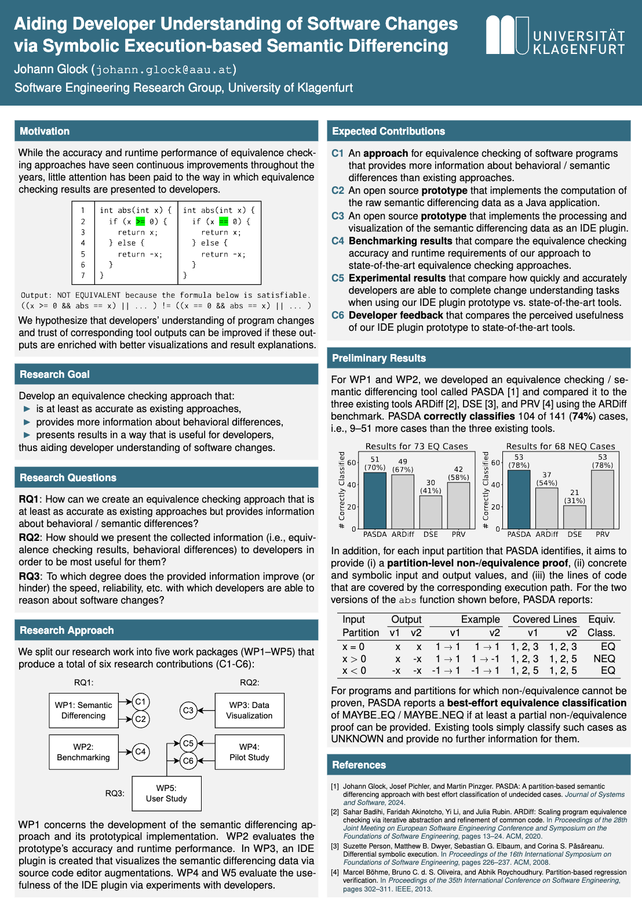

# Poster: Aiding Developer Understanding of Software Changes via Symbolic Execution-based Semantic Differencing

LaTeX sources of the poster that Johann Glock presented at the ICSE 2024 Doctoral Symposium in Lisbon. The poster, the paper and the slides of the talk are on [glockyco.com](https://glockyco.com/research/icse-2024-doctoral-symposium/).

[main.pdf](main.pdf) is the built poster.



## Build

You need a LaTeX distribution with `latexmk`:

```sh
latexmk -pdf main.tex
```

The figures are drawn with [draw.io](https://www.drawio.com). Each `.drawio` file has its exported `.drawio.pdf` next to it.

## Related

- [The paper](https://glockyco.com/research/icse-2024-doctoral-symposium/) and its [LaTeX sources](https://github.com/glockyco/icse2024-docsym-paper)
- [PASDA](https://glockyco.com/research/pasda/), the tool behind the preliminary results

## License

The text and the figures of the poster are licensed under [CC BY 4.0](LICENSE). `beamerthemeOxford.sty` keeps its own terms, and the license does not cover the logo of the University of Klagenfurt.
